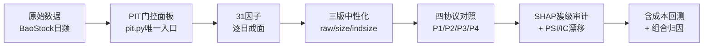
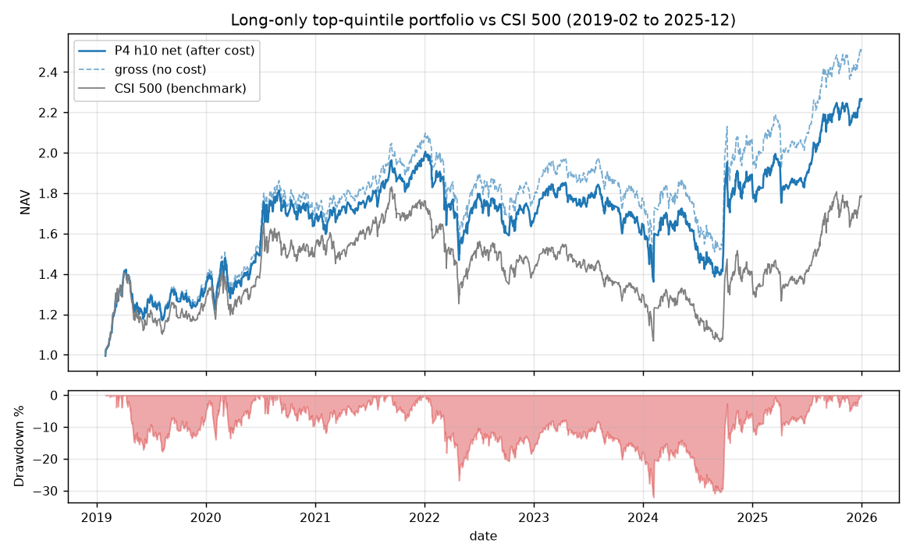
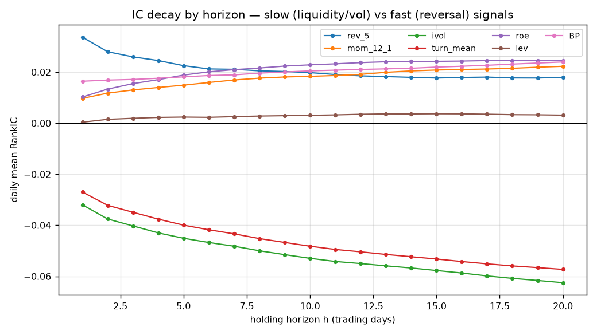
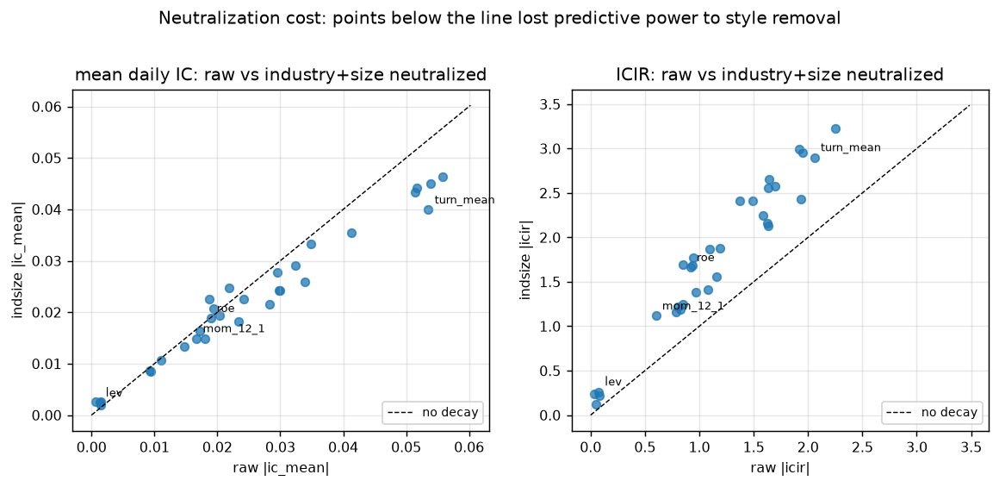
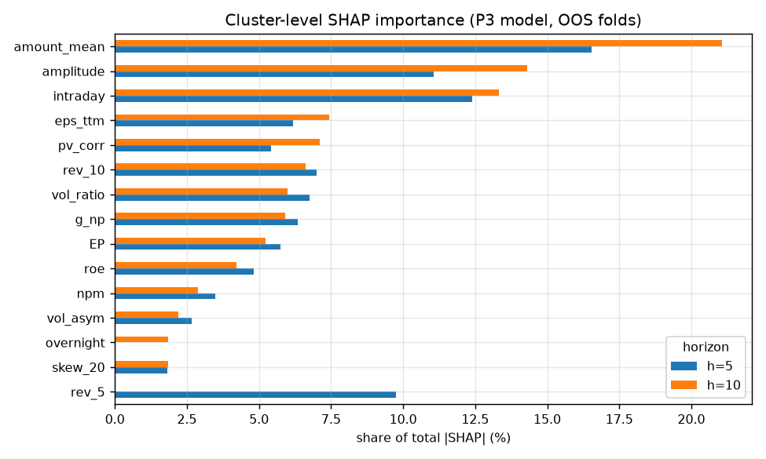
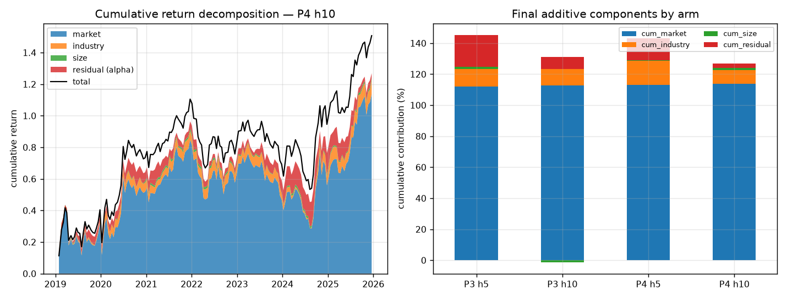
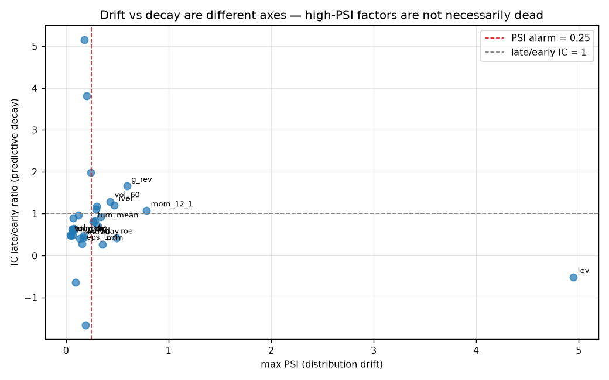

# 多因子合成与风险归因

> **在线演示 | Live Demo**: https://multi-factor-alpha.streamlit.app
> —— 交互式研究结果展示，浏览器直接访问，无需本地运行。

[](https://github.com/JUTIYOU/multi-factor-alpha/actions/workflows/test.yml)
[](https://multi-factor-alpha.streamlit.app/)
[](LICENSE)
[](https://www.python.org/)

A股日频公开数据上的"可解释多因子合成 + 风险暴露剥离 + 稳定性审计"研究链路。

## 核心结论(全部真实数字, 详见 reports/final_report.md)

- 26/31因子过初筛; 行业+市值中性化后流动性类IC衰减19-26%, 反转类反增13-20%
- **等权合成≥LGBM**(IC .055/.059 vs .053/.055); purge+embargo泄漏水分≈0; 重训+20%IC
- 含成本多头组合净年化～13%(Sharpe～0.7), 对中证500超额～4-4.7%/年
- 收益分解: 市场75-87% + 行业8-12% + size≈0 + 残差alpha 4-16%

## 结果速览



| NAV(净/毛/基准+回撤) | IC衰减(快反转vs慢流动性) | 中性化代价 |
|---|---|---|
|  |  |  |

| SHAP簇级份额 | 收益四段分解 | 漂移vs衰减两轴 |
|---|---|---|
|  |  |  |

## 数据源与口径

- BaoStock(主, 无Tushare→内部一致性对拍); 池=中证500月末历史成分(1217只)
- 行情2017-01～2025-12, 因子2018-01起, 测试2019-02起; 标签=5/10日前向收益截面rank
- PIT唯一入口 `src/data/pit.py`; 约定与防泄漏纪律见 `AGENTS.md`

## 复现路径

```bash
pip install -r requirements.txt
pytest tests/ -q                      # 17项合成测试(含复权/记账回归)
# 数据拉取(联网,低速档~3h; 断点续传): src/data/fetch_{universe,quotes,financials,industry_history}.py
python -m src.data.panel              # panel.parquet
python -m src.data.quality            # 质量报告 + GATE_T16.ok 门禁
python scripts/run_wp2.py             # reports/factor_*.csv + factors_all.parquet
python scripts/build_variants.py      # data/processed/factors_{raw,size,indsize}.parquet
python scripts/build_industry_map.py  # industry_map.parquet
python scripts/run_wp3.py             # reports/model_protocol_comparison.csv
python scripts/run_wp4.py             # reports/shap_*/factor_drift/ic_halflife.csv
python scripts/run_wp5.py             # reports/backtest_*.csv
python scripts/plot_figures.py        # figures/fig{1..6}_*.png
```

各阶段验收报告: `reports/wp{1..5}_acceptance.md`; 任务卡/泄漏清单: `docs/`。

## 结构

`src/data`(拉取/PIT/面板/质检) · `src/factors`(因子/预处理/中性化/IC/分箱) · `src/models`(标签/切分/训练/评估/SHAP/稳定性) · `src/backtest`(组合/成本/引擎/归因) · `configs/`(参数) · `tests/`(合成冒烟)
