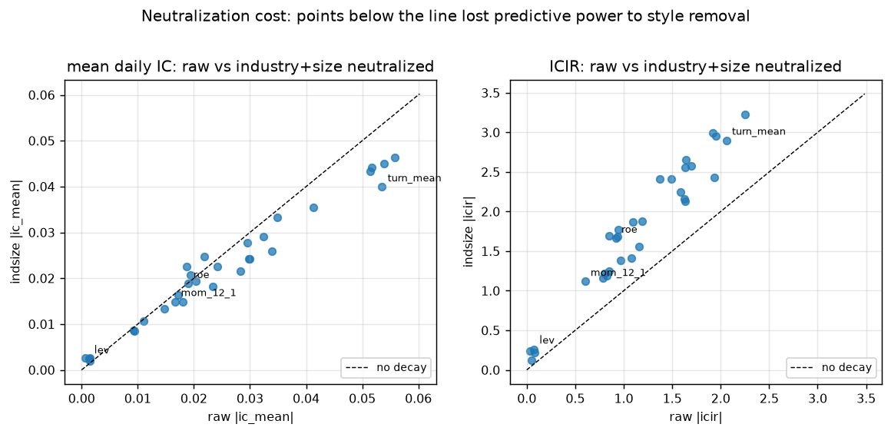
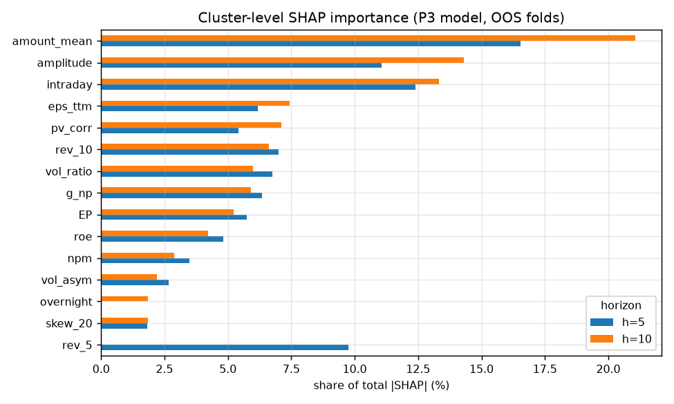
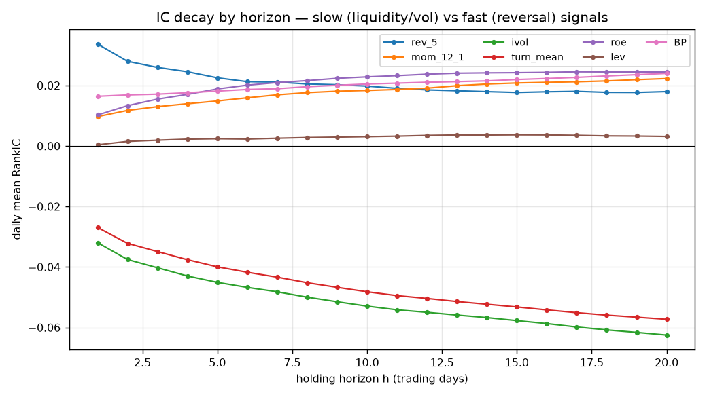
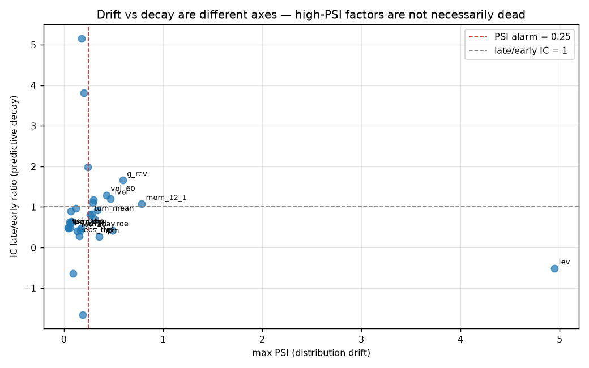
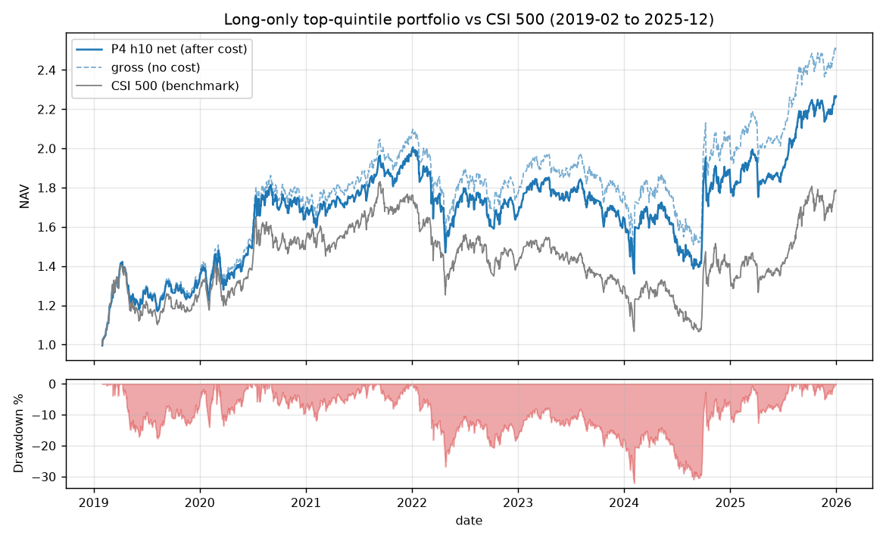
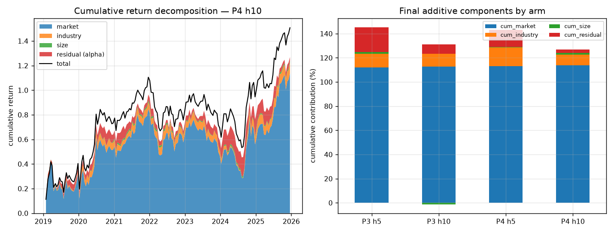

# 多因子合成与风险归因 — 研究报告

日期: 2026-11-16 | 数据: BaoStock | 池: 中证500历史成分(1217只) | 区间: 2018-01→2025-12(测试2019-02起) | 标签: 5/10日前向收益截面rank

## 摘要 (结论先行)

1. 31因子中26个通过初筛; **低波/流动性簇 RankIC≈-0.05 是最强信号**, 反转+0.02～+0.03, 估值/基本面+0.01～+0.03
2. **行业+市值中性化后流动性类IC衰减19-26%, 估值类10-23%**; 反转类反而增强13-20%(风格暴露掩蔽了真alpha); 26/26入选因子同号保持
3. **等权合成 ≥ LGBM**(P4 IC 0.055/0.059 vs P3 0.053/0.055, ICIR同步更高): 正交化干净因子上非线性增量≈0
4. **切边泄漏水分≈0**(P2 vs P3 ΔIC≈0.0005); 季度重训贡献+20%IC
5. 含成本多头组合(top20%等权): 净年化12.9-13.8%, Sharpe～0.7, 对中证500(+9.1%)**净超额～4-4.7%/年**
6. 组合收益分解: **市场β75-87%, 行业8-12%, size≈0, 残差alpha仅4-16%** —— 大部分"因子收益"本质是市场暴露
7. 过程中发现并修复2个会导致结论错误的bug(复权因子误用fwd5最大+2415万%、回测均值口径gross虚增+157%)——数据卫生比模型更重要

---

## 1. 数据与PIT (WP1)

- 1217只历史成分 × 2186交易日 = 241万行面板; tradable覆盖率44.3%
- 财务/股本可用日=`pubDate`(缺失兜底statDate+90d标记imputed); PIT抽查20/20通过
- 市值=close×当时已披露股本(pubDate门控); 拉取期2次BaoStock限流封禁,靠断点+重登+节流恢复
- 已知局限(披露): 同报告期重述覆盖带来的轻微前瞻; 行业为BaoStock自有口径且历史快照稀疏
- 质量报告 `reports/data_quality.md`; 验收 `reports/wp1_acceptance.md`

## 2. 研究问题①: 原始IC有多少是风格伪装? (WP2)

| 因子簇 | raw IC | indsize IC | 衰减 | 判定 |
|---|---|---|---|---|
| 换手/流动性 | -0.028～-0.054 | -0.022～-0.040 | **19-26%** | ～1/4是风格 |
| 低波簇 | -0.052～-0.056 | -0.043～-0.046 | 14-17% | 真异象为主 |
| 反转 | +0.019～+0.030 | +0.023～+0.028 | **负衰减** | 风格掩蔽真alpha |
| 估值 | +0.009～+0.032 | +0.009～+0.029 | 10-23% | BP最依赖市值 |
| 基本面 | +0.009～+0.019 | 持平 | ～0-10% | 独立 |

同号保持26/26; gpm/lev/g_rev/max_dd因|IC|<0.003淘汰 → **26因子入选**(`reports/factor_screening.csv`)。



## 3. 研究问题②: 中性化后是否同号、衰减多少?

同号保持率100%; 衰减上表。**raw vs indsize同协议合成对比**(P3): IC均值raw略高(+0.003～0.006)但**ICIR塌方34%**、价差波动+40%——风格贡献的IC是regime依赖的不稳定alpha, indsize确认为主线。

## 4. 训练协议三对比 + 等权基线 (WP3)

| variant | h | P1单折 | P2走样 | P3 purge+embargo | P4等权 |
|---|---|---|---|---|---|
| indsize | 5 | .044/.47 | .054/.52 | .053/.52 | **.055/.54** |
| indsize | 10 | .048/.51 | .055/.52 | .055/.52 | **.059/.57** |
| raw | 5/10 | — | — | .056/.34, .061/.38 | — |

- P2-P3≈0 → 本项目场景切边泄漏可忽略(但措施仍必要)
- 重训增益～+20%IC → 必须定期重训
- **等权≥LGBM**: 合成alpha来自因子广度而非模型复杂度(与截面ML文献一致)

## 5. 研究问题③④: SHAP归因与漂移 (WP4)

- **簇级重要性**(防信用稀释): 流动性簇16.5-21%, 日内行为簇12-13%, 波动簇11-14%, 基本面因子各自独立贡献→**高贡献因子=独立alpha而非风格代理**
- 折间重要性排名相关0.77-0.83(结构稳定); 重训复现corr=1.000000
- **漂移归因**: lev/roe/npm是真alpha衰减(decay_ratio -0.52/0.42/0.26); 波动类分布漂移但IC反而增强(拥挤度变化非alpha消失); 滚动IC曾触底～0(2024微盘崩盘)但恢复
- **IC半衰期**: 流动性/波动类|IC|随h单调增强(-0.027→-0.057) → 慢信号,支撑h10主线

 


## 6. 研究问题⑤: 组合收益分解 (WP5, 含成本)

执行: t收盘信号→t+1开盘买→持有h日开盘卖; 买5bp/卖15bp; 一字板处理; 续留免费。

| proto | h | 净年化 | Sharpe | MaxDD | 年换手 | 成本拖累 |
|---|---|---|---|---|---|---|
| P3/P4 | 5 | 13.2/13.8% | 0.70/0.73 | -31/-34% | 17.7/13.5x | 3.8/2.8% |
| P3/P4 | 10 | 12.9/13.1% | 0.70/0.71 | -29/-32% | 9.8/7.5x | 2.1/1.6% |

**收益分解(占期收益总额)**: 市场75-87% + 行业8-12% + size≈0 + **残差alpha 4-16%**。size贡献≈0验证中性化成功传导到组合层。

 

## 7. 过程中的重大教训 (诚实记录)

| bug | 影响 | 修复 | 教训 |
|---|---|---|---|
| 累计复权因子被再次cumprod | 单事件虚增+110%/除权日, fwd5最大+2415万% | as-of取累计因子+基线反推 | 复权因子语义必须实证确认(泄漏清单#19) |
| 回测日收益用在场腿均值 | 顺延腿把个股日行当组合日行, 7年虚增+75% | 固定权重Σr/N | 组合记账固定权重口径(#20) |
| 全样本筛选进模型 | 隐性selection bias | 嵌套:每折train窗内重筛 | 特征筛选也在泄漏面上 |

## 8. 复现路径

```
pip install -r requirements.txt
# 数据(需联网, ~3h低速档): src/data/fetch_{universe,quotes,financials,industry_history}.py
python -m src.data.panel              # 建面板
python -m src.data.quality            # 质量报告 + GATE_T16.ok 门禁
python scripts/run_wp2.py             # 因子表+中性化对比+factors_all
python scripts/build_variants.py      # 三版因子矩阵
python scripts/build_industry_map.py  # PIT行业映射
python scripts/run_wp3.py             # 4协议对比
python scripts/run_wp4.py             # SHAP+漂移+半衰期
python scripts/run_wp5.py             # 含成本回测+归因
python scripts/plot_figures.py        # figures/fig{1..6}_*.png
pytest tests/ -q                      # 17项合成测试(含复权/记账回归)
```

## 9. 已知局限

重述前瞻; BaoStock行业口径非申万; 无资金流/情绪数据; 成本为常数参数未按流动性分层; top组容量～100只等权未评估冲击成本上限; 分层中部非单调(已披露); 等权/树模型以外方法未比较。
